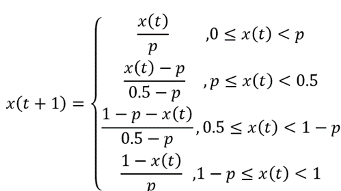
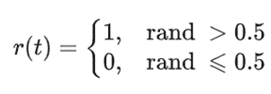
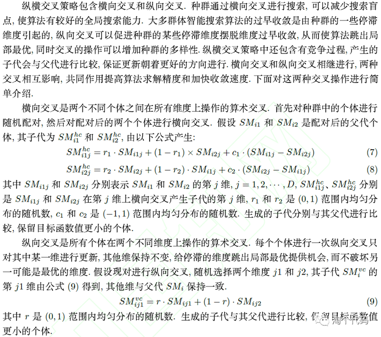
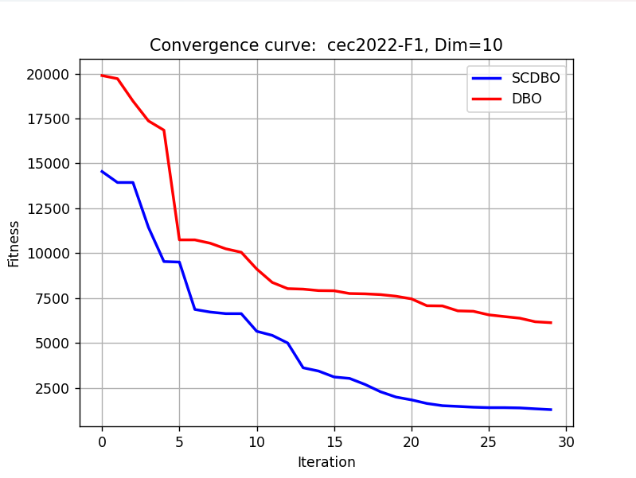
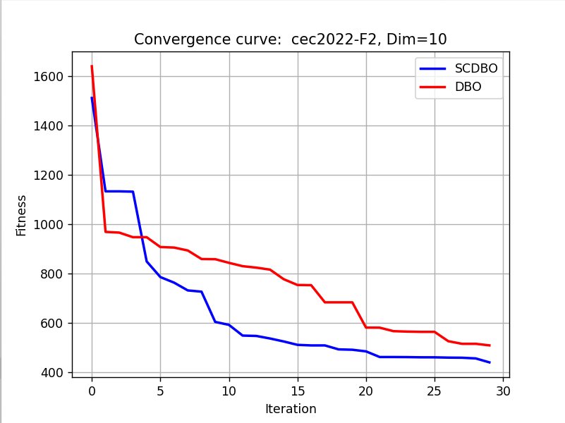

# Improved Dung Beetle Python (Random Walk + Straight Cross)

This content and innovation points are sufficient to write a paper! Those interested in it, please download quickly to obtain the code. 
Detailed Explanation of Improvement Strategies:
① Piecewise Chaos Map for Initializing the Bee Swarm Population
Due to the random initialization of the basic bee search algorithm's population, it is impossible to ensure that individual positions are uniformly distributed within the search space, which affects the algorithm's search speed and optimization performance. In the improvement of the bee algorithm's initialization process, a Piecewise mapping was introduced to increase the exploration capability of the initial population.
You can directly modify the first parameter of the chaos() function in the code, changing different chaos maps. A total of ten types of chaos maps are available for selection!
The principle of Piecewise mapping is as follows:
Chaos mapping is a method for generating chaotic sequences. Common methods of chaos mapping include Logistic mapping, Tent mapping, and Circle mapping. As a typical representative of chaos mapping, Piecewise mapping has a simple mathematical form and possesses both exploration and randomness. Piecewise chaos mapping is also known as PWLCM chaos mapping, and its description is as follows:
The principle of Piecewise mapping refers to the principle of using piecewise functions to describe an overall function. It divides the definition domain of the overall function into several subintervals and defines corresponding expressions on each subinterval. Thus, the overall function can be obtained by combining these subinterval expressions. The formula is as follows:
② Random Walk Strategy for Perturbing the Bee Ball Rolling Behavior
The random walk strategy formula is as follows:
Take a random function r(t) such as the one above.
Since the action trajectory of intelligent algorithms has a certain range, it cannot be directly used in the above formula to update the algorithm's position. To ensure that the algorithm walks within a certain range, normalization needs to be performed, as shown below.
In the formula:
Xit represents the position of the ith Dung Beetle at the tth iteration; αi and bj are the minimum and maximum values of the random walk variable in the ith dimension, respectively; cij and dij are the minimum and maximum values of the random walk variable in the ith dimension at the tth iteration.
References for the stochastic walk strategy include: Ma Xiaojing, He Hang, Wang Hongjun et al. A Maximal Entropy Dichotomy Method Based on an Improved Sparrow Search Algorithm [J]. Science and Technology and Engineering, 2023, 23(16): 6983-6992.
The cross-crossover strategy is applied to perturb the Dung Beetle's rolling ball behavior. This strategy is added at the end of the Dung Beetle algorithm and perturbs the entire Dung Beetle population. To avoid increasing the complexity of the algorithm, a cross-crossover strategy factor pv is introduced this time. The details of the improvements will not be disclosed further.

## Images

<!-- PAYMENT_BLOCK -->

## Get this dataset

- Payment link (Stripe): [Buy now](https://buy.stripe.com/3cs8yP7sY87d0vu9AB)
- Payment QR code: 

<!-- /PAYMENT_BLOCK -->
